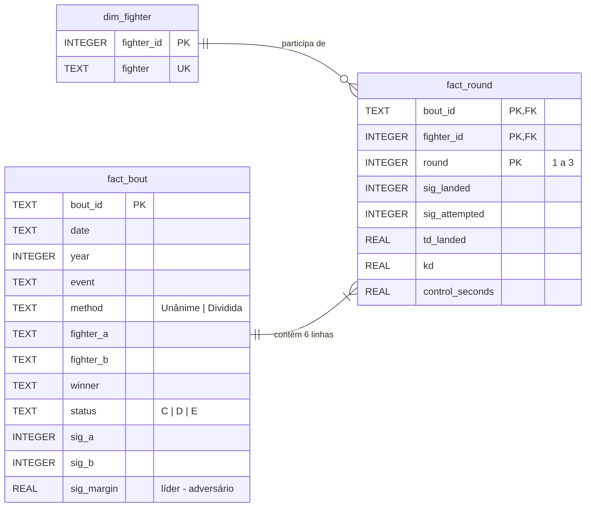

# Modelo de dados e camada SQL

Banco: SQLite 3, gerado por `src/pipeline.py` a partir de [`sql/schema.sql`](../sql/schema.sql). As regras de qualidade ficam no próprio banco (PK, FK, UNIQUE, CHECK), e não apenas no código Python.



Fonte do diagrama: `docs/modelo_er.mmd` (Mermaid).

## Tabelas

| Tabela | Grão | Chave | Papel |
|---|---|---|---|
| `dim_fighter` | 1 linha por atleta | `fighter_id` (PK), `fighter` (UNIQUE) | Dimensão de atletas |
| `fact_bout` | 1 linha por luta | `bout_id` (PK) | Fato com placar de golpes, classificação C/D/E e variáveis do modelo |
| `fact_round` | 1 linha por atleta × round | (`bout_id`, `fighter_id`, `round`) | Fato detalhado; FK para `fact_bout` e `dim_fighter` |

Cardinalidades: uma luta tem exatamente 6 linhas em `fact_round` (2 atletas × 3 rounds); um atleta pode aparecer em várias lutas.

## Restrições de integridade

| Regra | Onde |
|---|---|
| `status` ∈ {C, D, E} e `method` ∈ {Unânime, Dividida} | CHECK em `fact_bout` |
| Ano entre 2022 e 2024 e data no formato ISO | CHECK em `fact_bout` |
| Empate (`E`) se e somente se `sig_a = sig_b` | CHECK de consistência entre colunas |
| O vencedor é um dos dois atletas da luta | CHECK em `fact_bout` |
| Round entre 1 e 3; acertos ≤ tentativas; controle entre 0 e 300 s | CHECK em `fact_round` |
| Round sempre pertence a uma luta e a um atleta existentes | FOREIGN KEY (com `ON DELETE CASCADE` para a luta) |
| Sem duplicidade de atleta × round na mesma luta | PRIMARY KEY composta |

A carga termina com `PRAGMA integrity_check` e `PRAGMA foreign_key_check`; qualquer falha interrompe o pipeline.

## Visões (camada semântica de BI)

| Visão | Conteúdo |
|---|---|
| `vw_bout_kpis` | Contagens C/D/E e concordância por ano e método; `NULLIF` evita divisão por zero |
| `vw_divergences` | Lutas em que o líder em golpes perdeu, com placar |
| `vw_round_detail` | Rounds já unidos ao nome do atleta e à data da luta |

## Consultas de referência

`sql/consultas.sql` traz sete consultas (KPI global, H2 por decisão, estabilidade anual, maiores divergências, caso Holland, ranking com função de janela e auditoria de integridade). Execução:

```bash
sqlite3 data/processed/ufc.sqlite < sql/consultas.sql
```

`tests/test_project.py` executa todas elas e confere a visão `vw_bout_kpis` contra o cálculo em Python.

## Índices

`ix_bout_year_method` (filtros do painel por ano e método), `ix_bout_status` (consulta de divergências) e `ix_round_fighter` (histórico por atleta).

## Consumo pelo painel

As visões SQL servem às consultas analíticas e à reconciliação. `src/visuals.py` lê os CSVs tratados e os JSONs de resultados, incorpora os dados no HTML e gera o painel. O navegador filtra esses dados em JavaScript, sem conexão direta ao SQLite.
